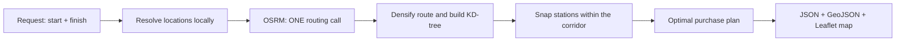

<div align="center">

# ⛽ Fuel Route Planner

**A Django REST API that plans the cheapest fuel stops along any driving route in the contiguous USA.**


</div>

Give it a start and a finish. It returns the driving route, the fuel stops that minimise total cost for a
500-mile-range vehicle at 10 MPG, and the total money spent on fuel. It also ships an interactive Leaflet map.

---

## Table of contents

- [⛽ Fuel Route Planner](#-fuel-route-planner)
  - [Table of contents](#table-of-contents)
  - [Highlights](#highlights)
  - [Quick start](#quick-start)
    - [Option A: Docker](#option-a-docker)
    - [Option B: Local virtual environment](#option-b-local-virtual-environment)
  - [API reference](#api-reference)
    - [`POST /api/route/`](#post-apiroute)
    - [`GET /route-map/`](#get-route-map)
    - [Postman collection](#postman-collection)
  - [How it works](#how-it-works)
  - [Design decisions](#design-decisions)
  - [Assumptions and limitations](#assumptions-and-limitations)
  - [Configuration](#configuration)
  - [Testing](#testing)
  - [Project structure](#project-structure)
  - [Troubleshooting](#troubleshooting)
  - [Possible next steps](#possible-next-steps)
  - [Author](#author)

---

## Highlights

| Requirement | How it is met |
|---|---|
| Start and finish anywhere in the USA | Accepts `"City, ST"`, ZIP code, or `lat,lon`; resolved **locally**, no geocoding API |
| Route map and optimal fuel stops | GeoJSON route plus an interactive Leaflet map at `/route-map/` |
| 500-mile max range, multiple fuel-ups | Planned in legs of at most **450 miles** (50-mile safety buffer) |
| Total fuel spend at 10 MPG | Exact `Decimal` arithmetic; the total equals the sum of the stop costs |
| Uses the supplied price file | 6,626 US stations loaded from `data/fuel-prices-for-be-assessment.csv` |
| Fast responses | Typically **16 to 45 ms of local compute** (measured); the rest is the routing call |
| One call to the routing API | **Exactly one** OSRM request per API call, no retries |
| Latest stable Django | Django 6.1 + Django REST Framework 3.18 |

---

## Quick start

### Option A: Docker

```bash
git clone https://github.com/Talha-coding1/fuel-route-planner.git
cd fuel-route-planner
docker compose up --build
```

On first boot the container runs migrations and loads the fuel data automatically. When the log shows
`station index warmed: 6626 stations`, open:

| What | URL |
|---|---|
| Interactive map | <http://localhost:8000/route-map/> |
| API endpoint | `POST http://localhost:8000/api/route/` |

Stop with `Ctrl+C`, then `docker compose down`. Data persists in the `fuel_data` volume.

### Option B: Local virtual environment

Requires **Python 3.12 or newer**.

```bash
git clone https://github.com/Talha-coding1/fuel-route-planner.git
cd fuel-route-planner

python -m venv venv
```

Activate the environment:

```powershell
# Windows (PowerShell)
venv\Scripts\Activate.ps1
```

```bash
# macOS / Linux
source venv/bin/activate
```

Then install, load the data and run:

```bash
pip install -r requirements.txt
python manage.py migrate
python manage.py load_fuel_data
python manage.py runserver
```

Expected output of `load_fuel_data`:

```
rows=8151 unique_stations=6738 loaded=6626 skipped_non_us=112 skipped_ungeocoded=0
```

Open <http://127.0.0.1:8000/route-map/>.

> Docker and the local server both use port 8000, so run only one at a time.

---

## API reference

### `POST /api/route/`

(`GET /api/route/?start=...&finish=...` is also supported.)

```bash
curl -X POST http://localhost:8000/api/route/ \
  -H "Content-Type: application/json" \
  -d '{"start": "Chicago, IL", "finish": "Dallas, TX"}'
```

**Accepted location formats**

| Format | Example |
|---|---|
| City and state | `"Chicago, IL"` or `"Chicago, Illinois"` |
| ZIP code | `"75201"` |
| Coordinates | `"34.05,-118.24"` or `{"lat": 34.05, "lon": -118.24}` |

Locations must be inside the contiguous USA.

**Example response** (real output for Chicago → Dallas, abridged; timings vary per run)

```jsonc
{
  "start":  {"label": "Chicago, IL", "lat": 41.85068, "lon": -87.67915},
  "finish": {"label": "Dallas, TX",  "lat": 32.78941, "lon": -96.7896},
  "route": {
    "distance_miles": 967.4,
    "duration_hours": 17.1,
    "geojson": {
      "type": "Feature",
      "properties": {},
      "geometry": {"type": "LineString", "coordinates": [[-87.67916, 41.85], "..."]}
    }
  },
  "fuel_stops": [
    {
      "order": 1,
      "name": "HUCKS FOOD & FUEL #379",
      "address": "I-57, EXIT 53",
      "city": "Marion",
      "state": "IL",
      "price_per_gallon": 2.929,
      "gallons": 31.787,
      "cost": 93.1,
      "route_mile": 317.9,
      "miles_since_previous_stop": 317.9
      // plus offset_from_route_miles and location {lat, lon}
    }
    // ... 4 more stops
  ],
  "summary": {
    "total_fuel_cost_usd": 149.71,
    "total_gallons_purchased": 51.746,
    "trip_gallons_required": 96.746,
    "stop_count": 5,
    "stations_in_corridor": 188
  },
  "assumptions": {
    "usable_range_miles": 450.0,
    "mpg": 10.0,
    "corridor_miles": 10.0,
    "starting_fuel_miles": 450.0,
    "initial_tank_billed": false,
    "station_location_precision": "city centroid"
  },
  "timings_ms": {"routing_api": 1496.0, "local_compute": 16.5}
}
```

**Response fields**

| Field | Meaning |
|---|---|
| `route.geojson` | Route line for drawing (thinned to at most 2,500 points) |
| `fuel_stops[]` | Chosen stops with name, address, city, state, price per gallon, gallons bought and cost |
| `route_mile` | Distance from the start at which the stop occurs |
| `offset_from_route_miles` | How far the station is from the route line |
| `summary.total_fuel_cost_usd` | Total money spent on fuel |
| `timings_ms` | Time in the routing call versus local computation |

**Error responses**

| Status | `error` | Meaning |
|---|---|---|
| `400` | field errors | Unresolvable or non-US location, missing field, or start equal to finish |
| `422` | `no_fuel_in_range` | A gap on the route is longer than the usable range |
| `502` | `routing_provider_error` | The routing service failed or found no route |

Invalid input is rejected before any external call is made.

### `GET /route-map/`

Interactive map. Enter a start and finish, and it draws the route, numbered stop pins with popups,
and a side panel with per-stop details and the total cost. Links such as
`/route-map/?start=Chicago,IL&finish=Dallas,TX` are shareable.

### Postman collection

`docs/Fuel_Route_API.postman_collection.json` contains seven saved requests (long trip, short trip with no
stops, invalid location, same start and finish, missing field, coordinates input, cross-country). In Postman:
**Import** and choose the file.

---

## How it works



1. **Resolve locations.** Text such as `"Chicago, IL"` is matched against an offline gazetteer built from the
   `zipcodes` package. No network call.
2. **One routing call.** `routing/services/osrm.py` requests the full route geometry once and decodes it locally.
3. **Snap stations to the route.** The route is densified to 0.5-mile points and indexed in a KD-tree (SciPy).
   Every station within 10 miles of the route is assigned a mile marker along it.
4. **Choose stops.** A greedy algorithm walks the route:
   - If a **cheaper station is reachable** on a full tank, buy only enough fuel to reach the nearest one.
   - Otherwise **fill up** and drive to the cheapest reachable station.
5. **Price it.** Gallons and costs use `Decimal`; the destination is reached with no fuel wasted.

This is optimal for the fixed-capacity gas-station problem, and the test suite confirms it against a
brute-force dynamic-programming solver on 400 random instances.

---

## Design decisions

| Decision | Reason |
|---|---|
| Stations held in memory per worker | About 6.6k rows; requests never touch the database, and workers warm up at start |
| KD-tree on unit-sphere coordinates | Exact nearest-point search with no map-projection error |
| `polyline6` geometry from OSRM | Much smaller download than GeoJSON for long routes |
| No retries on the routing call | Guarantees the "one call per request" limit |
| Thin views, logic in `services/` | Pure, easily tested functions; the API layer only validates and serialises |
| SQLite | The data set is small and read-mostly; no extra service to run |

---

## Assumptions and limitations

1. **Station coordinates are city-level.** The CSV contains only city and state, so each station is placed at
   its city's ZIP-code centroid. A station's reported position can be a few miles from its real exit. The
   10-mile corridor and the 50-mile range buffer absorb this.
2. **Starting tank.** The vehicle departs with a full usable tank (450 miles) that is **not billed**, so trips
   shorter than that cost $0. Override with `STARTING_FUEL_MILES`.
3. **Duplicate rows.** About 600 stations list several prices; the lowest is used
   (`load_fuel_data --price-strategy min|mean|max`). The 112 Canadian stations are excluded.
4. **Detours** to reach a station (its offset from the route) are reported, but their fuel is not billed.
5. **Small top-ups.** The plan is cost-optimal, so it can include purchases of only a few gallons when a slightly
   cheaper station is next.
6. **Public OSRM demo server.** It is rate-limited and typically takes 1 to 4 seconds per request. Point
   `OSRM_BASE_URL` at your own instance for production.
7. **Contiguous USA only.** OSRM cannot route to Alaska or Hawaii from the mainland.

---

## Configuration

Environment variables (see `.env.example`):

| Variable | Default | Purpose |
|---|---|---|
| `OSRM_BASE_URL` | `https://router.project-osrm.org` | Routing provider |
| `VEHICLE_MAX_RANGE_MILES` | `500` | Tank range |
| `SAFETY_BUFFER_MILES` | `50` | Usable leg = range minus buffer |
| `VEHICLE_MPG` | `10` | Fuel efficiency |
| `CORRIDOR_MILES` | `10` | Maximum station distance from the route |
| `STARTING_FUEL_MILES` | full usable tank | Initial fuel, not billed |
| `MAP_MAX_GEOMETRY_POINTS` | `2500` | Route points returned for drawing |
| `DJANGO_SECRET_KEY` | none | Required when `DJANGO_DEBUG=0` |
| `DJANGO_DEBUG` | `1` locally, `0` in Docker | Debug mode |
| `WEB_CONCURRENCY` | `2` | Gunicorn workers |
| `SQLITE_PATH` | `./db.sqlite3` (`/data/db.sqlite3` in Docker) | Database file |

---

## Testing

```bash
python manage.py test
```

28 tests, none of which need internet access. They cover:

- **Optimizer:** range boundaries (450 miles reachable, 450.5 not), infeasible gaps, corridor filtering,
  skipping expensive stations, exact cost and gallon arithmetic, and a comparison with a brute-force DP solver.
- **Routing client:** polyline decoding round trip, exactly one HTTP call, no retry on failure, error handling.
- **API:** success payload, input validation, 400/422/502 responses, and that bad input never reaches OSRM.
- **Data loading and geocoding:** de-duplication, price strategy, non-US filtering, city-name normalisation.

---

## Project structure

```
fuel-route-planner/
├── manage.py
├── requirements.txt
├── Dockerfile
├── docker-compose.yml
├── gunicorn.conf.py
├── docker/entrypoint.sh              migrate + first-boot data load
├── data/
│   └── fuel-prices-for-be-assessment.csv
├── docs/
│   └── Fuel_Route_API.postman_collection.json
├── config/                           settings, urls, wsgi
├── stations/
│   ├── models.py                     FuelStation
│   ├── management/commands/load_fuel_data.py
│   ├── services/
│   │   ├── geocoding.py              offline gazetteer + location parsing
│   │   └── station_index.py          in-memory station table
│   └── tests.py
└── routing/
    ├── views.py, serializers.py, urls.py
    ├── templates/routing/route_map.html     Leaflet map page
    ├── services/
    │   ├── osrm.py                   single-call routing client
    │   ├── geo.py                    spherical geometry, route densifying
    │   ├── fuel_optimizer.py         corridor snap + optimal purchases
    │   ├── trip_planner.py           orchestration
    │   ├── presenter.py              JSON / GeoJSON payload
    │   └── exceptions.py
    └── tests/                        optimizer, OSRM client, API tests
```

---

## Troubleshooting

| Problem | Fix |
|---|---|
| Docker build fails with `Could not find a version that satisfies the requirement ...` | A network timeout while installing packages. Run `docker compose up --build` again. |
| Docker container exits with `no such file or directory` for `entrypoint.sh` | The script has Windows (CRLF) line endings. Convert it to LF; `.gitattributes` prevents this on fresh clones. |
| `port is already allocated` or address in use | Another server uses port 8000. Stop it, or set `PORT=8001`. |
| API returns `502 routing_provider_error` | The public OSRM server is busy or unreachable. Wait a minute and retry. |
| Map tiles stay blank | The page loads tiles from OpenStreetMap; check your internet connection. |
| `CommandError: CSV not found` | Run commands from the project root, where `data/` lives. |
| `No matching distribution for Django==6.1.2` | Python is older than 3.12. Install Python 3.12 or newer. |

---

## Possible next steps

- Cache repeated start/finish pairs so repeat requests return instantly.
- Optional minimum-purchase rule to avoid very small top-ups.
- Street-level station geocoding for exact positions.
- Self-hosted OSRM for faster, unthrottled routing.
- GitHub Actions workflow to run the tests on every push.

---

## Author

**Muhammad Talha** · [github.com/Talha-coding1](https://github.com/Talha-coding1)